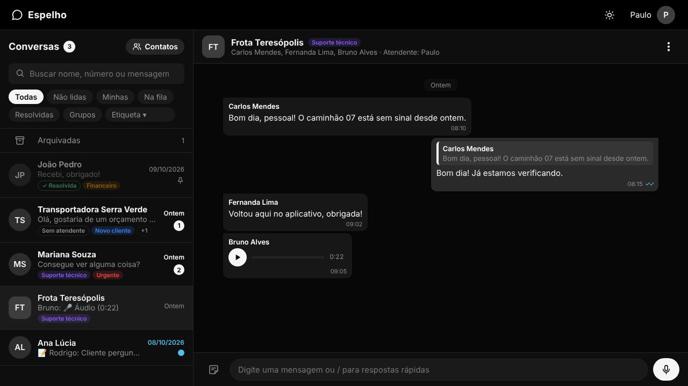
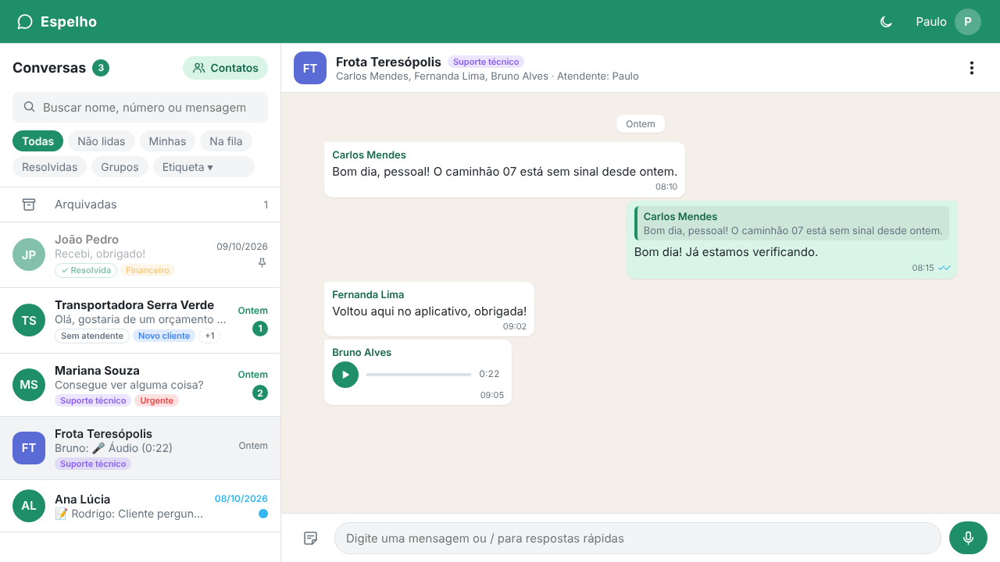

# Espelho

Painel de atendimento via WhatsApp pensado para **equipes**: vários atendentes no mesmo número, com fila, transferência, notas internas e etiquetas. Feito em **HTML, CSS e JavaScript puro**, sem frameworks.

**[Ver o projeto funcionando](https://thepaulojorge.github.io/clonewpp/)**



<details>
<summary>Ver no tema claro</summary>



</details>

## Por que este projeto existe

Comecei o Espelho depois de usar ferramentas de atendimento via WhatsApp com problemas de usabilidade, e quis resolver cada um deles:

| Problema | Como o Espelho resolve |
| --- | --- |
| O contador de não lidas não diminuía ao abrir a conversa | O total nunca é guardado: ele é **calculado** a partir das mensagens, então não tem como ficar fora de sincronia |
| O título da aba não mostrava pendências | A aba mostra `(5) Espelho`, como o WhatsApp Web |
| Busca ruim | Busca por nome, número em qualquer formato, conteúdo das mensagens e etiquetas, ignorando acentos |
| Grupo e contato pareciam iguais | Avatar quadrado para grupos, com o nome de quem falou em cada mensagem |
| Não dava para marcar como não lida | Marcação manual com uma cor própria, diferente das mensagens novas |
| Iniciar conversa abria um formulário de e-mail | Um clique no contato, ou digitar o número e apertar Enter |
| Um número, várias pessoas | Fila, "assumir", transferir, filtro "Minhas" e histórico de quem fez o quê |

## O que dá para fazer

**Conversas**
- Fixar até 3 conversas no topo, arquivar, excluir e marcar como lida ou não lida (pelo menu ⋮ ou pelo botão direito)
- Filtros: Todas, Não lidas, Minhas, Na fila, Resolvidas, Grupos e por etiqueta
- Passar o mouse sobre uma conversa mostra um cartão com a última mensagem inteira

**Mensagens**
- Enviar texto e **gravar e ouvir áudios** (com a API `MediaRecorder` do navegador)
- Responder citando uma mensagem; clicar na citação leva até a original
- Editar e apagar as próprias mensagens, mantendo o histórico
- Respostas rápidas: digite `/` e escolha um modelo, como `/saudacao`
- Rascunho salvo por conversa

**Equipe**
- Assumir e transferir conversas, ou devolver para a fila
- **Notas internas**: mensagens amarelas que só a equipe vê
- Status "Resolvida", que reabre sozinho quando o cliente escreve de novo
- Etiquetas coloridas, três delas com nome personalizável
- **Simular login** como outro atendente (clique no nome, no topo) para ver a ferramenta pelos olhos de cada pessoa

**Interface**
- Tema escuro e tema claro, com a escolha salva no navegador
- Layout responsivo: no celular, uma tela por vez
- Atalhos: `Esc` fecha menus, janelas e a conversa; setas e `Enter` nas respostas rápidas
- Acessibilidade: navegação por teclado, `aria-label` nos botões de ícone, foco visível

## Decisões técnicas

- **Estado único:** tudo o que aparece na tela vem de um objeto `estado`. As funções nunca editam a tela diretamente; elas mudam o estado e chamam `atualizarTela()`. Isso elimina telas fora de sincronia.
- **Dados que se referenciam por id:** as conversas guardam `contatoId`, `atendenteId` e ids de etiquetas, nunca cópias. Renomear uma etiqueta muda todas as conversas de uma vez.
- **Delegação de eventos:** um único ouvinte de clique por lista, em vez de um por item, que continua funcionando quando a lista é redesenhada.
- **Segurança:** o texto das mensagens entra na página com `textContent`, nunca com `innerHTML`, para que uma mensagem com código não seja executada (XSS).
- **Soft delete:** mensagens apagadas são marcadas, não removidas, para que citações e o histórico continuem fazendo sentido.
- **Um ponto de entrada para mensagens recebidas:** `receberMensagem()` concentra as regras (reabrir conversa resolvida, marcar como lida se estiver aberta). Hoje quem chama é um simulador; com um backend, será o WebSocket, sem mudar as regras.
- **Temas com variáveis CSS:** as variáveis têm nomes de **função** (`--destaque`, `--fundo-painel`), não de cor. O tema claro só troca os valores. Um script curto no `<head>` aplica o tema salvo antes da página aparecer, para a tela não piscar.
- **Ícones SVG** num único objeto JS, com `currentColor`: mudam de cor junto com o tema.

## Como rodar no seu computador

Os dados ficam no arquivo `dados.json`, carregado com `fetch`. Por isso o projeto precisa de um servidor local: abrir o `index.html` com dois cliques não funciona.

1. Clone o repositório
2. Abra a pasta no VS Code
3. Clique com o botão direito no `index.html` e escolha **Open with Live Server**

Para gravar áudio, o navegador vai pedir permissão para usar o microfone. Isso só funciona em `localhost` ou em sites com HTTPS, como o GitHub Pages.

## Arquivos

```
index.html   estrutura da página
style.css    visual, temas e layout responsivo
script.js    toda a lógica, dividida em seções comentadas
dados.json   contatos, conversas, atendentes, etiquetas e respostas rápidas de exemplo
favicon.svg  ícone da aba
```

## Limitações (por enquanto)

Esta é a versão de **front-end**, com dados de exemplo:

- Nada é salvo: ao recarregar a página, as conversas voltam ao estado do `dados.json` (o tema escolhido é a exceção).
- As ações marcadas com 🧪 no menu são **simulações** para teste, como "Simular mensagem do cliente". A confirmação de leitura (✓✓ azul) também é simulada.
- Os áudios gravados existem só enquanto a página está aberta.
- O "login" é uma simulação para alternar entre atendentes.

## Próximos passos

- [ ] Salvar os dados no navegador (`localStorage`)
- [ ] Backend em Node.js + Express para guardar conversas e arquivos de áudio
- [ ] Mensagens em tempo real entre atendentes com WebSocket (Socket.io)
- [ ] Login de verdade para cada atendente
- [ ] Integração com a API oficial do WhatsApp (WhatsApp Business Cloud API)

## Autor

Feito por **Paulo Jorge**, desenvolvedor front-end.

[Portfólio](https://thepaulojorge.github.io/portfoliopaulojorge/)

---

Projeto de estudo e portfólio. Não tem ligação com o WhatsApp nem com a Meta.
